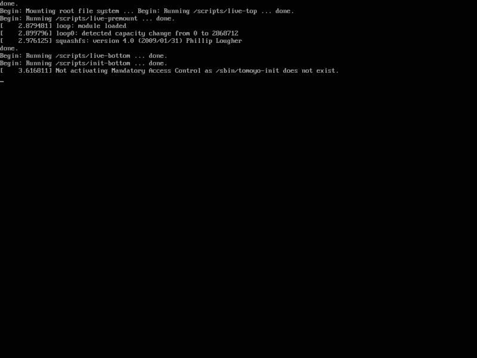

# AI 电脑维修 U盘 — 一根 U盘，一座 AI 电脑铺 🛠️

> 坏电脑：U盘启动进中文 AI 维修系统，对话就能修。好电脑：同一根 U盘插上就是免安装 AI 工作站——Claude Code、Codex CLI，零安装、零残留。**工具跟人走，不跟机器走。**

[](../../releases) [](LICENSE) [](README.md)



*启动 → 挂载数据分区 → 网络诊断 → AI 维修助手主菜单（QEMU 虚拟机实录 v0.3 ISO）。*

**一根 U盘，四种身份：**

| | 干什么 |
|---|---|
| 🔧 **AI 维修工程师** | 开不了机、蓝屏死循环、忘密码、BitLocker 锁死？U盘启动进定制 Debian 12 Live，AI 带你磁盘体检、抢救数据、重置密码、重装系统。危险操作全部先列计划、二次确认。 |
| 📄 **办公助手** | 好电脑双击 `AI-Workstation` 选「办公助手」：写文案、Excel 公式、邮件润色、报告排版。全程不需要管理员权限，不改系统任何设置——借同事的电脑也安心。 |
| 💻 **装机大师** | Windows 10/11 镜像运行时向微软官网动态换取官方直链（本项目不分发微软任何字节）；Debian 12 netinst 随盘内置。 |
| 🤖 **随身 AI 引擎** | Codex CLI、OpenClaw、Pi 随盘携带，预接任意 Anthropic/OpenAI 兼容网关，换台电脑插上就能用。 |

> **适用范围：** 维修模式从 U 盘启动任意 PC，面向 Windows 维修（含 Debian 装机）；工作站模式插在好电脑的 Windows 主机上即用。制作器支持 Windows / Linux / macOS 三平台。

## 快速开始

**Windows**（管理员 PowerShell；空白U盘 ⚠️ 会被清空）：

```powershell
irm https://usb.tokeneff.com/maker/usb-v1.0.ps1 | iex
```

**Linux / macOS：**

```bash
curl -sL https://usb.tokeneff.com/maker/usb-v1.0.sh | sudo bash
```

想先审阅脚本？`curl -sLO https://usb.tokeneff.com/maker/usb-v1.0.sh && less usb-v1.0.sh`——所有组件均钉 SHA256 校验。

制作器中文问答式勾选（Claude Code / Codex / Windows 镜像 / Debian），邮箱验证后自动发放 AI 免费额度，经 Ventoy 写盘——断网可续传，全程无需值守。

## 用自己的 key / 自建网关

U盘 对接任意 Anthropic 兼容端点（tokeneff.com 官方托管只是其中一个选项，送每周免费额度）：

```bash
export ANTHROPIC_BASE_URL=https://你的网关
export ANTHROPIC_AUTH_TOKEN=sk-你的key
```

10 分钟自建 LiteLLM 网关教程见 [docs/self-hosted-gateway.md](docs/self-hosted-gateway.md)。

## 为什么不直接……

| | 微PE / FirPE | 裸 Ventoy | 手动装 Claude Code |
|---|---|---|---|
| AI 对话式维修 | ❌ | ❌ | ❌ |
| 坏电脑上可用 | ❌（WinPE 工具，无 AI） | ❌ | ❌ |
| 好电脑零安装 | n/a | n/a | ❌ |
| 中文优先交互 | ✅ | 菜单 | 终端 |
| 重装 Windows + Debian | ✅ | 手动 | ❌ |

## 复现 ISO

```bash
sudo bash setup-build-host.sh      # Debian 12 构建机
cd live-build-config && sudo bash build.sh
bash tests/smoke.sh                # 15/15 无硬件冒烟测试
```

完整方案见 [01-planning/README.md](01-planning/README.md)。

## 安全与免责

- 一行命令安装器执行的是远程脚本——介意者请先审阅；同 URL 始终提供静态脚本。
- 涉及写盘的维修操作都会先列计划并二次确认。但仍然：**修机前先备份。**
- Windows 镜像在制作/使用时直接从微软官方服务器下载，本项目不分发微软任何字节。

## 路线图

- [x] v0.1 — 首个可启动 ISO（Claude Code + 中文维修菜单）
- [x] v0.3 — 内置 Claude 技能集（智能诊断/数据抢救等）+ 桌面直启 + Win/Linux 一行命令制作器
- [x] v0.3.x — Codex CLI 组件 + Windows 侧 AI-Workstation 启动器
- [ ] v0.4 — 便携 Node + OpenClaw + Pi（便携多 Agent 工作站）
- [ ] v0.5 — 维修菜单与 AI-Workstation 启动器双语化（中/EN）
- [ ] WinPE 构建器、维修记录系统、英文文档

## 参与贡献

Issue 与 PR 欢迎，见 [CONTRIBUTING.md](CONTRIBUTING.md)。冒烟测试套件无需任何硬件，5 分钟可验证一处改动。

## 许可证

[MIT](LICENSE)。Ventoy 等随盘上游组件保留其自身许可证。
